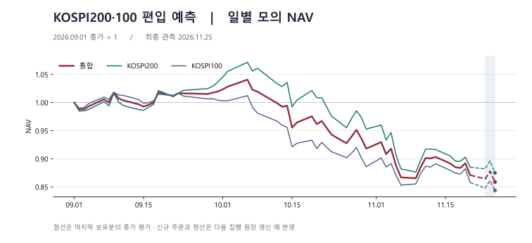

# KOSPI100·KOSPI200 정기 편입 예측 전략
정기변경 공표 전에 당시 이용 가능한 시가총액과 지수 심사 기준으로 신규 편입 후보를 예측한다. 두 지수에 각각 100억 원을 배분해 심사마감 80·60·40·20거래일 전에 네 차례 나눠 매수한다. 예측에서 탈락한 종목은 공표 다음 거래일 종가부터 유동성 한도 안에서 청산한다.

## 일별 모의 NAV

[일별 수익률과 NAV 내려받기](보고서/일별_NAV.csv) · [전략보고서 PDF](보고서/QUANTIFI_지수편입_전략보고서.pdf) · [제안서 원본 PDF](보고서/주식운용_지수편입예측_조현모_제안서.pdf)

2026년 9월 1일 **종가**가 1이다. CSV에는 기준일의 전일 대비 수익률도 담았다. 기준일 이후의 누적수익률은 표시 NAV에서 1을 빼면 된다.

실선은 기존 집행 원장에 포함된 OOS다. 점선은 마지막으로 확인된 두 계좌의 현금과 보유분을 이후 KRX 종가로 평가한 참고 경로다. 점선 구간의 신규 체결·현금배당은 가정하지 않는다. 새 집행 원장이 들어오면 해당 날짜를 실선으로 교체한다. 기업행위로 가격 연결이 끊기거나 예정 청산일에 도달하면 원장 확인 전까지 보유분 평가를 연장하지 않는다. CSV에는 후속 구간만 첫날 종가 1로 환산한 통합 NAV도 있다.

### 갱신 방법

이 프로젝트의 Windows 작업 스케줄러는 한국 시각 평일 20:40과 화~토 07:40에 공식 마감 시세를 확인한다. 등록된 사용자의 로그인과 인터넷 연결이 필요하다. 양 시장의 자료가 게시된 마지막 거래일까지 갱신하며, 다음 실행에서 누락 날짜를 따라잡는다. 진행 상태는 로컬 `비공개자료/일별_NAV_갱신.log`에 기록한다.

- 현재 원장으로 그래프를 다시 그릴 때는 `python daily_nav.py`를 실행한다. 지수 전략의 후속 종가 평가까지 갱신할 때는 아래 명령을 사용한다.
- 일별 시세 조회와 평가를 실행하려면 `python refresh_nav.py`, 결과를 GitHub에도 게시하려면 `python refresh_nav.py --publish`를 실행한다. KRX 유가증권·코스닥 일별매매정보 권한이 있는 키 파일의 위치를 `KRX_KEY_FILE` 환경변수로 설정한다.

[이전 자료 목록](이전자료_목록.csv)에서 최초 이관 자료와 원본 해시를 확인할 수 있다.

## 연구 자료

| 공개 자료 | 확인할 내용 |
| --- | --- |
| [전략 노트북](03_notebooks/KOSPI200_KOSPI100_전략_제출용.ipynb) | 선정 규정, 예측 엔진, 회차별 집행, 비용 민감도와 팩터 회귀 |
| [발표자료](보고서/주식운용_지수편입예측_조현모_제안서.pdf) · [전략보고서](보고서/QUANTIFI_지수편입_전략보고서.pdf) | 최신 발표본 18쪽에 2026년 12월 편입 예측과 공표 명단 비교 수록 |
| [일별 모의 포트폴리오](포트폴리오_일별_실제보유.csv) | 날짜·종목코드·보유 비중·전략 신호·현금 |
| [성과 원장](04_results/kospi_pair_optimized_trend_20261124/) · [체결률 분석](04_results/kospi_pair_capacity_20261124/) | 일별 계좌 성과와 예산에 따른 회차별 매수 체결 |
| [연구 코드](02_code/) | 규정 적용, 심사기간의 시가총액 추정, 집행과 검증 |

2023년 1월 2일~2026년 11월 20일 통합 모의계좌의 최종 자산은 433.98억 원, CAGR 22.08%, 샤프지수 0.96, 최대낙폭 −26.43%였다. 두 전략이 같은 종목을 같은 날 매매할 경우 거래대금 한도를 공유했다.

2026년 12월 KOSPI200 정기변경에서 네 차수 후보를 중복 없이 집계하면 8개였고 모두 공표 명단에 포함됐다. 실제 신규 편입 11개 기준 재현율은 72.7%다.

**재현 범위**  
공개 노트북은 포함된 집계 자료로 성과표를 읽을 수 있다. 3팩터 회귀는 저장된 추정 결과를 표시하며, 해당 경로에 원래 형식의 일별 팩터 입력을 두면 다시 추정한다. 원시 시세에서 후보 생성부터 재실행하려면 FnGuide 등 별도 이용 권한이 있는 입력이 필요하다. 연구 원자료와 증권사 리포트 원문은 로컬 비공개자료 폴더에 보관한다.
